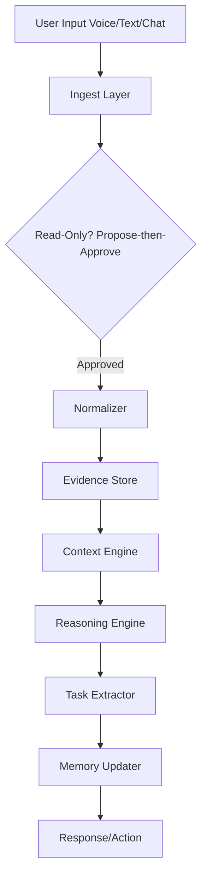

# ATIF ASSISTANT - MASTER FULL PLAN
Version: 1.0 | Date: 2026-10-13
Local-First | Human+AI Hybrid | Privacy-First

## System Architecture Flowchart


## Phases 0-9 (Easy -> Hard, Each Standalone)

### P0 - Foundation
Goal: Stabilize core, CRUD complete, tests green. Standalone-if-missing: Yes.

### P1 - Connectors
Goal: Drive/Gmail/WhatsApp/local, read-only, propose-approve. Standalone-if-missing: Yes.

### P2 - Task Extraction
Goal: Auto-extract tasks from chats, todos. Standalone-if-missing: Yes.

### P3 - Memory Enrichment
Goal: Auto-update facts, link people/places. Standalone-if-missing: Yes.

### P4 - Perception
Goal: Glasses: voice/tone/face, on-device. Standalone-if-missing: Yes.

### P5 - Spatial/Home Mapping
Goal: Objects/materials/shapes, home 3D prep. Standalone-if-missing: Yes.

### P6 - Reasoning/Capability
Goal: Strength vs object, human context. Standalone-if-missing: Yes.

### P7 - Offline LLM Opt
Goal: Small models, chunking, piecewise merge. Standalone-if-missing: Yes.

### P8 - 3D Reconstruction
Goal: Progressive home 3D. Standalone-if-missing: Yes.

### P9 - Polish/Deploy
Goal: Local-only, self-contained. Standalone-if-missing: Yes.

## Tree Structure
```text
Atif Assistant
├── Core (evidence-based)
├── Connectors (Drive/Gmail/WhatsApp/Local)
├── Memory (Facts/Episodes/People/Places/Tasks/Rules)
├── Perception (Voice/Tone/Face/Scene)
├── Reasoning (Piecewise, Capability)
├── Tasks (Auto-extract + Todos)
└── Local LLM (Ollama, small models)
```
